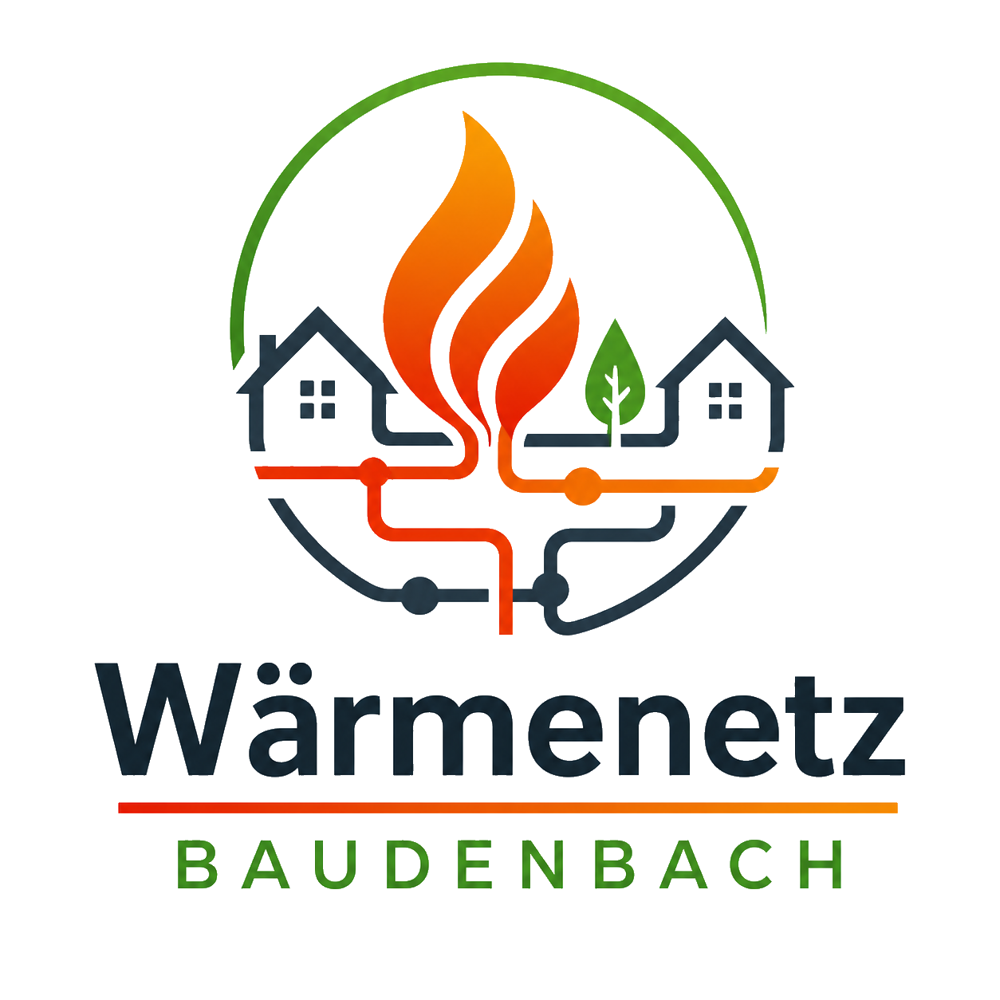
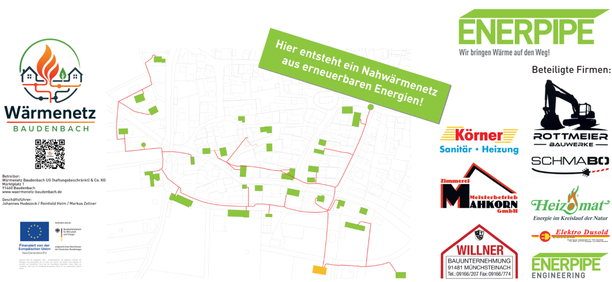
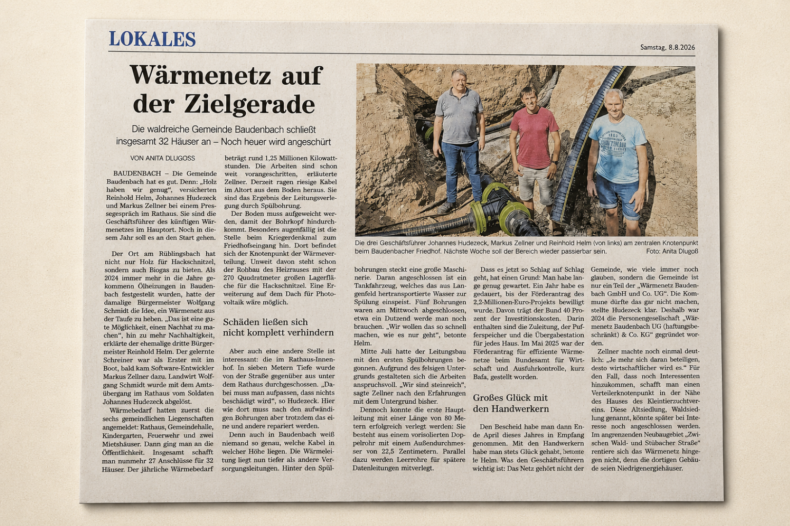

!!! info "Aktueller Hinweis"

    Vielen Dank für die vielen Rückmeldungen für die geplante Erweiterung!  
    Alle technisch möglichen Anwesen haben eine persönliche schriftliche Einladung zu einer weiteren Versammlung erhalten.  
    Weitere Informationen erhalten sie [hier](Projekt/Erweiterung.md).
{ width="400" loading=lazy .off-glb }

## Baudenbach denkt heute schon an morgen!

{ loading=lazy .off-glb }

## Zeitungsbericht FLZ 08.08.2026

{ loading=lazy width=400px data-title="Zeitungsbericht FLZ 08.08.2026" }

## Projektbericht der Firma Enerpipe 

:material-link: [Gemeinsam für die Wärme der Zukunft: Baudenbach setzt auf genossenschaftliche Nahwärme](https://www.enerpipe.de/projekte/projekt/gemeinsam-fuer-die-waerme-der-zukunft-baudenbach-setzt-auf-genossenschaftliche-nahwaerme){ :target="_blank" }